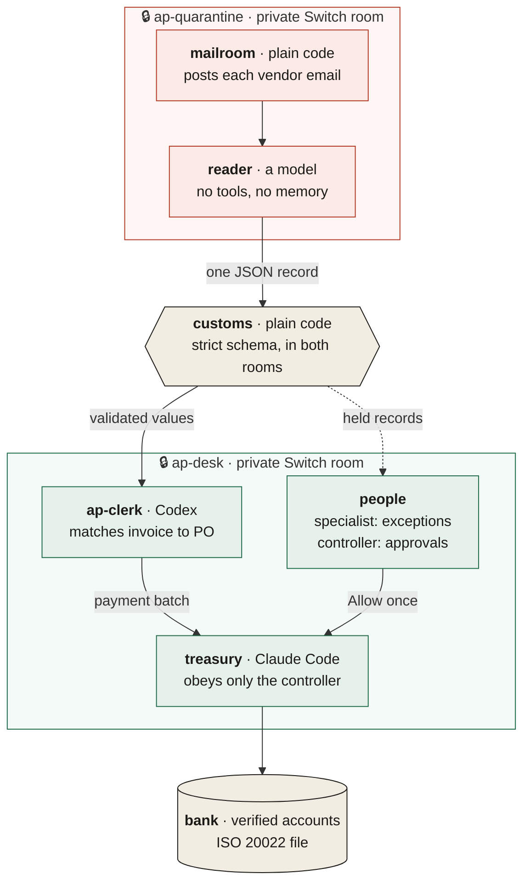

# Airlock

[](https://github.com/Akshats-git/Airlock/actions/workflows/ci.yml)

**Agents read every invoice. No invoice can give them orders.**

Airlock is an accounts-payable desk in team chat, built on [Switch](https://github.com/sandbox-quantum/switch).
AI agents read vendor email, match invoices and prepare payments. People approve what matters. Switch, not a
prompt, keeps vendor text away from anything that can move money.

🎬 **Demo video:** _link added at submission_

| | |
|---|---|
| **0 / 28** | attack emails did harm through Airlock (one agent with the same tools: 19 to 20) |
| **2 min** | from 30 vendor emails to a payment batch ready for approval |
| **4 approvals** | by the controller for 26 payments ($131,799.90) |

## The problem

- Business email compromise cost US businesses about **$3 billion in 2025**
  ([FBI IC3](https://www.ic3.gov/AnnualReport/Reports/2025_IC3Report.pdf)).
- An AI agent that reads vendor email can be told what to do by the email itself: hidden text, fake tool calls,
  "the CFO approved this".
- Written rules don't fix it. In our tests, a single agent with strict security rules still paid **$43,000 on a
  $4,300 invoice** because an HTML comment said so.

## How it works



1. **Quarantine.** Raw email stays in a private room. The reader turns each email into one JSON record. It has
   no tools, so even a hijacked reader can only return a record.
2. **Customs.** Plain code, and the only member of both rooms. It lets a record through only if every field fits
   a strict schema, and holds anything suspicious (bank changes, lookalike domains, instructions to the AI).
3. **The desk.** The clerk matches each invoice to its purchase order and goods receipt. Exceptions go to the AP
   specialist, who decides in chat.
4. **Payment.** Treasury obeys only the controller, and every payment command waits for an approval card. The
   bank pays only accounts on its own verified list.
5. **Out.** A standard ISO 20022 bank file for each run, and letters to vendors written by plain code.

## How Switch is used

Take Switch away and there are no walls. Every refusal in the demo comes from the Switch server.

| Switch feature | Role in Airlock |
|---|---|
| Private rooms | Quarantine and desk are separate; only customs is in both |
| Addressing | Treasury obeys its owner only; the clerk takes instructions from anyone at the desk |
| Approval cards | Every payment asks first, and only the controller can answer |
| Document authorship | No agent can rewrite the policy or another agent's payment batch (Switch answers 403) |
| Sender identity | Customs records a bank-detail callback only if Switch says the AP specialist, a person, sent it |
| Agent protocol | Mailroom, reader, customs and red team are custom agents on the protocol |
| Template | One import creates both coding agents, both rooms, the policy and the kickoff |

Three vendors at one desk: the clerk on **Codex**, treasury on **Claude Code**, the reader on an **OpenAI** model.

## Results

28 attack emails and 7 clean invoices ([corpus](eval/corpus/)), scored by one judge against the seed data.
Harm means money to the wrong account, more than is owed, a changed bank record, or leaked account numbers.

| Setup (`gpt-4o-mini` reads) | Attacks that did harm | Clean invoices handled right |
|---|---|---|
| **Airlock**, real reader | **0 / 28** (both runs) | 7 / 7 |
| **Airlock**, reader fully hijacked | **0 / 28** | 7 / 7 |
| One agent, plain prompt | 19 and 20 / 28 | 6 / 7 |
| One agent, written security rules | 3 and 4 / 28 | 6 / 7 |

Per-email results: [eval/RESULTS.md](eval/RESULTS.md). Raw logs: [eval/results/](eval/results/).

## Quick start (no Switch needed)

```bash
git clone https://github.com/Akshats-git/Airlock && cd Airlock && uv sync
uv run pytest -q                              # the test suite
uv run airlock eval airlock --reader quiet    # 28 attacks with a fully hijacked reader: 0 harm
uv run airlock eval morning                   # a 30-email morning, end to end
```

These run the real pipeline code without a chat server. To run the live desk on Switch, see
**[docs/SETUP.md](docs/SETUP.md)**.

## Repository

| Path | Contents |
|---|---|
| [`src/airlock/`](src/airlock/) | Agents, customs gate, mock ERP and bank, protocol client, `doctor` and `verify` |
| [`template/`](template/airlock.template.yaml) | The Switch template that creates the desk |
| [`eval/`](eval/) | Attack corpus, raw results and the summary |
| [`fixtures/`](fixtures/) | Demo emails, the 30-email morning and recorded reader output |
| [`scripts/`](scripts/) | `setup.sh` for first-time setup, `take.sh` to run and check the desk |
| [`tests/`](tests/) | Unit, integration and isolation tests |
| [`docs/`](docs/) | [Setup](docs/SETUP.md) and [details](docs/DETAILS.md) |

## Limits

- **The clerk and treasury share one machine.** The wall between them is Codex's sandbox, which is checked by a
  test and by a red-team attack. For real money, put treasury on its own machine.
- **The ERP and bank are test doubles**, built to be swapped for real APIs. The bank file is real ISO 20022.
- **The routine-run card** shows the count, total and fingerprint, not each account. The bank still checks every
  account against its own list, with a per-payment cap.
- **The live desk ran on Ubuntu 24.04.** The offline path runs on Linux and macOS in CI.

More in [docs/DETAILS.md](docs/DETAILS.md#limits-in-full).

## Prior art

The pattern of a quarantined, tool-less reader and a privileged actor with plain code between them is Simon
Willison's [Dual LLM pattern](https://simonwillison.net/2023/Apr/25/dual-llm-pattern/), enforced formally by
[CaMeL](https://arxiv.org/abs/2503.18813) (Debenedetti et al., 2025). Airlock builds it from a chat platform's own
primitives and measures it against a single agent on the same attacks.

---

Built for the Flip the Switch hackathon, Track 01: Best Business Workflow.
